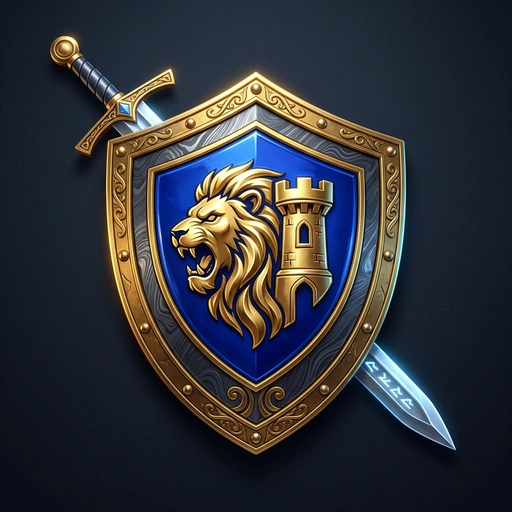
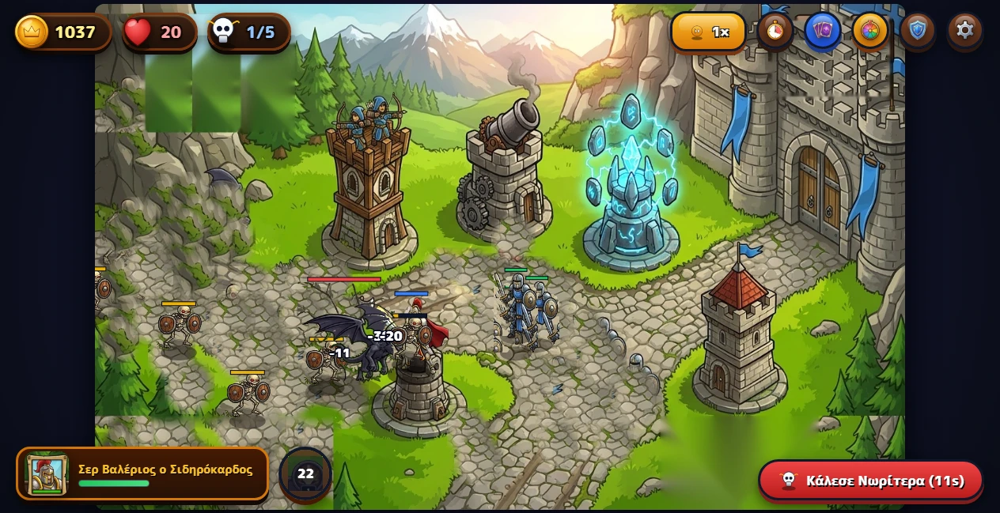
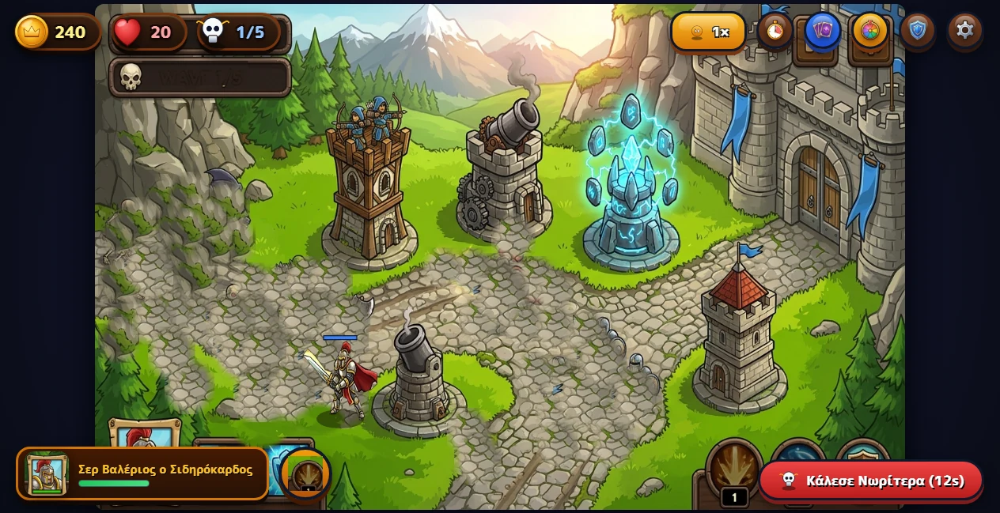
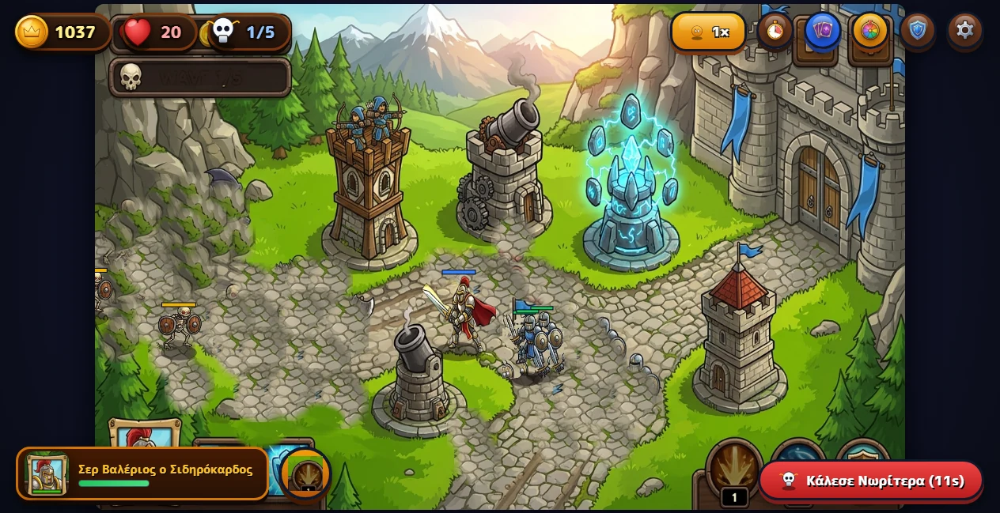
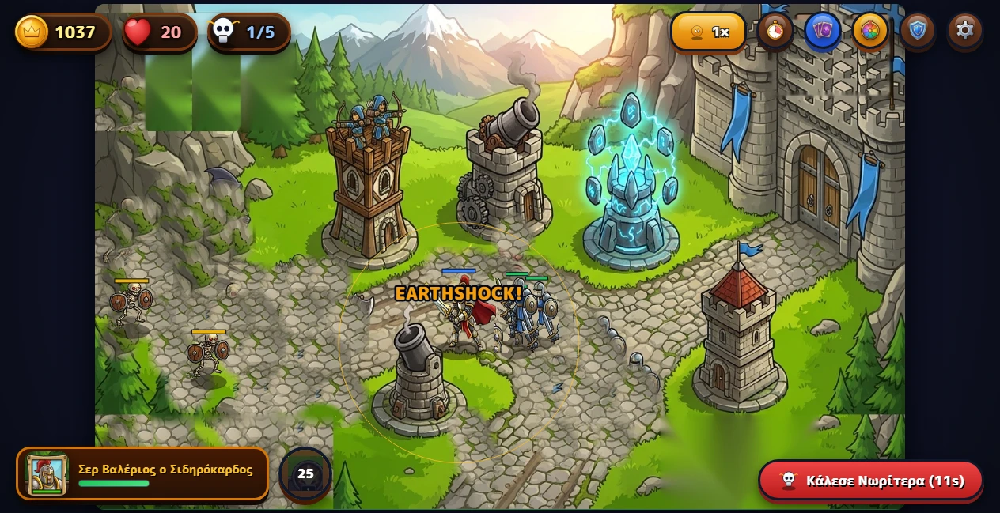
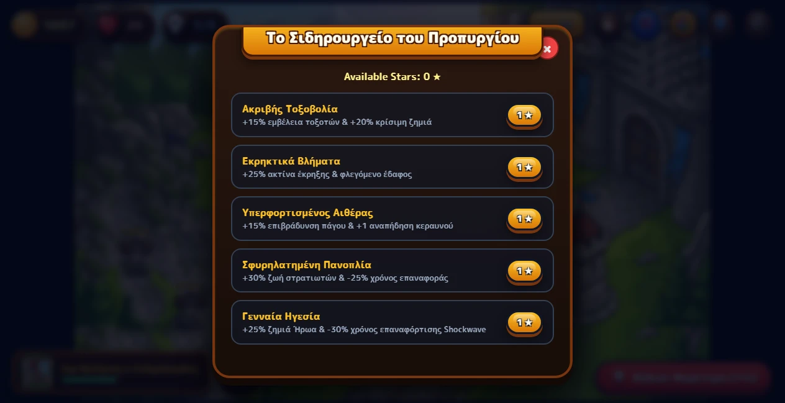
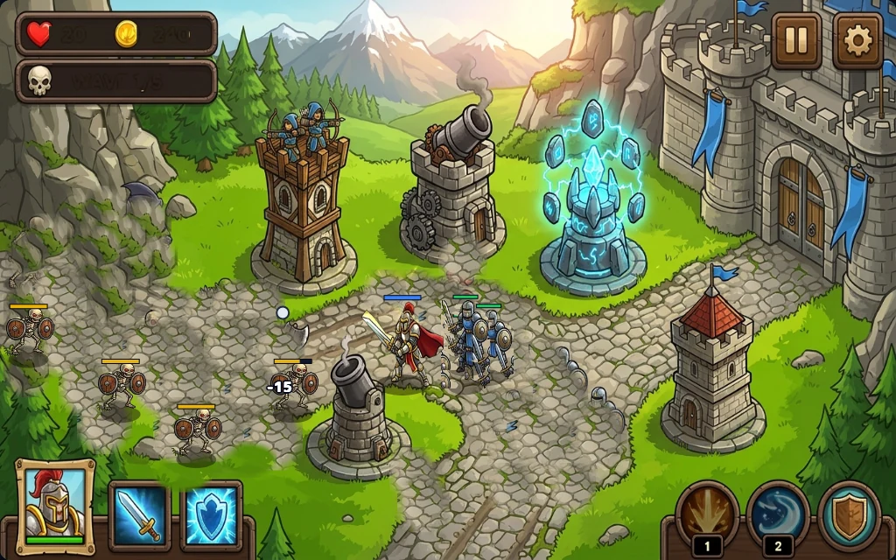

# 🛡️ Bastion Guard — Tactical Medieval Tower Defense

  
  &nbsp;&nbsp;&nbsp;&nbsp;
  

  <strong>Classic Tactical Tower Defense for Android</strong> 
  <em>Fortify chokepoints, command barracks stall squads, and unleash your movable Hero against mythic hordes!</em>

  

  
  

  
  
  
  
  

---

## 📥 Direct APK Download

Always get the latest official Android APK build from this permanent direct link:

👉 **[Download bastion-guard.apk (Latest Release)](https://github.com/jemangr/bastion-guard-releases/releases/latest/download/bastion-guard.apk)** 👈

*(Or view all versions on the [GitHub Releases Page](https://github.com/jemangr/bastion-guard-releases/releases).)*

---

## ✨ Key Highlights (`v1.2.0 — Cel-Shaded Graphics Overhaul`)

- 🎨 **Hand-Painted Cel-Shaded Graphics Overhaul:**
  - 16 custom-rendered fortress towers across 4 tiers with genuine stone masonry blocks, wood grain timber posts, iron bracing, gears, and pulsating crystals.
  - Hand-painted scenic biomes with organic cobblestone pathways, cart ruts, and earthen embankments.
  - High-definition hero card and wooden carved HUD capsules with golden filigree.
- 🏹 **4 Core Tower Archetypes with 4 Upgrade Tiers (16 unique visual towers):**
  - **Longbow / Ballista:** Rapid single-target arrows. Excellent against swift and flying enemies.
  - **Catapult / Mortar:** Heavy parabolic artillery with devastating AoE crater blasts.
  - **Rune Spire (Frost & Lightning):** Freezing frost slow aura + chain lightning zapping up to 4 targets.
  - **Guard Barracks:** Deploys 3 armored swordsmen onto the road to rally, stall, and tank enemies in melee!
- 👑 **Movable Hero Commander (Sir Valerius the Shield):**
  - Reposition Sir Valerius anywhere on the field in real time.
  - Active ultimate power: **Earth Shockwave** (stuns all enemies in a 185px radius and deals seismic damage).
- ⚔️ **Mythic Enemy Hordes (Zero Goblins):**
  - Skeleton Scouts, Orc Berserkers, Flying Shadow Chimeras (bypass ground barricades), Iron Trolls, and the colossal **Abyssal Wyrm Dragon** Apex Boss!
- 🗺️ **5 Hand-Crafted Campaign Chapters:**
  - *The Whispering Defile*, *Ironwood Crossroad*, *Sunken Causeway*, *Dragon's Throat*, and *The Citadel Apex*.
- ⭐ **The Bastion Forge & Armory Vault:**
  - Earn 3-star ratings across battles and invest Stars in permanent skill trees (Archery, Mortars, Arcane, Barracks, Commander).
- 📺 **Smart & Fair Monetization Engine (`window.BastionGuardAds`):**
  - Rewarded Video options: Double Victory Gold & Stars, Emergency Citadel Reinforcements, Daily Armory Vault spin, and Tower Overcharge Runes.
  - FTUE grace period (6 minutes) and smart cooldown for interstitials.
- 📱 **Standalone Android APK:**
  - 100% offline gameplay, hardware-accelerated WebView, offline Greek cartoon font `GameDisplay` (`M PLUS Rounded 1c`), zero external Gradle/Node dependencies.

---

## 📸 Screenshots Gallery

| 1. Τακτικό Πεδίο Μάχης & Κόμβοι | 2. Πλήρης Άμυνα & Τάγμα Φρουράς |
| :---: | :---: |
|  |  |

| 3. Σεισμικό Κύμα Ήρωα (Earth Shockwave) | 4. Το Σιδηρουργείο του Προπυργίου (Upgrades) |
| :---: | :---: |
|  |  |

| 5. Αναμέτρηση με τον Δράκο Wyrm (Boss Wave) | 6. Cinematic Καθαρή Μάχη (Χωρίς Μενού) |
| :---: | :---: |
|  |  |

---

## 📜 License

Proprietary License — All Rights Reserved.  
Copyright (c) 2026 Giannis (`contact@jemangr.app`).
